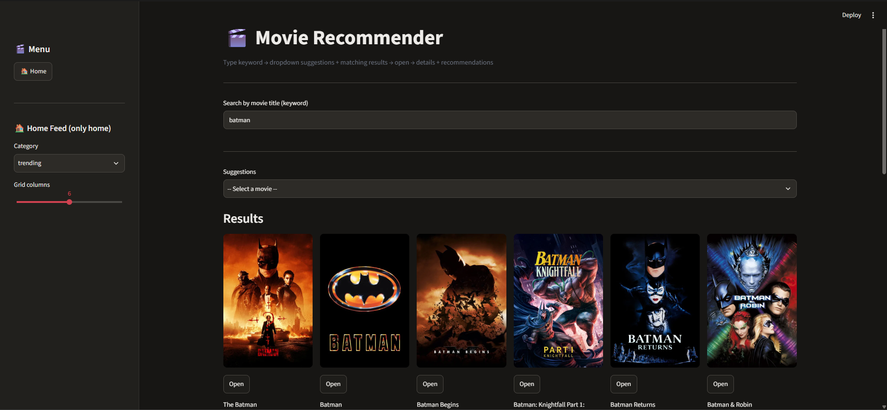
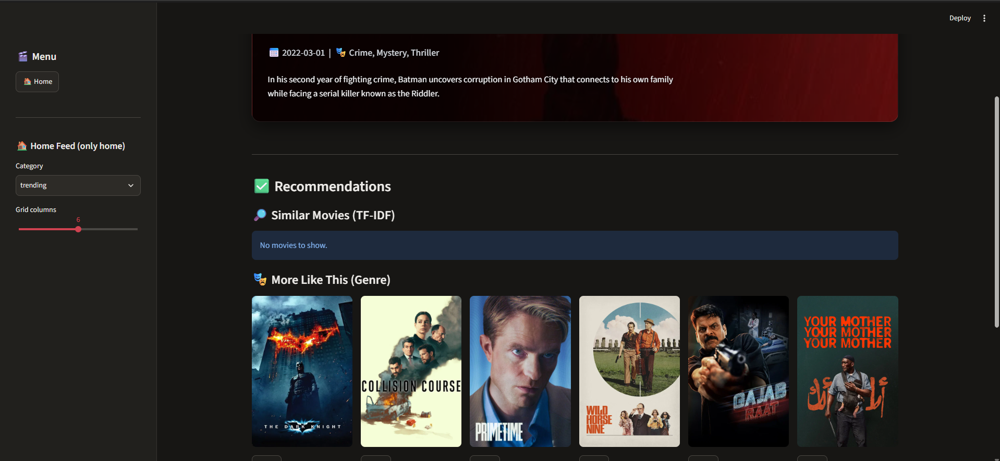

<div align="center">


<br/>


</div>

---

<div align="center">

```
╔══════════════════════════════════════════════════════════════╗
║                                                              ║
║   🎟️   A D M I T   O N E   —   N O W   S H O W I N G   🎟️   ║
║                                                              ║
║        THE MOVIE RECOMMENDATION SYSTEM  ·  TF-IDF · ML       ║
║                                                              ║
║      Screen 1  ·  Doors open 8:00 PM  ·  Seat: Front Row     ║
║                                                              ║
╚══════════════════════════════════════════════════════════════╝
```

</div>

## 🎬 Now Showing

Walk into the theatre, pick a movie, and let the system do the rest.

**Movie Recommender** is a full-stack, content-based recommendation engine. It uses **TF-IDF** and **Cosine Similarity** to understand what a film is *about* (its genres, plot, keywords, cast, and crew) and finds the movies that feel most like it. A modern, Netflix-style web UI, powered by the **TMDB API**, brings every title to life with real posters, backdrops, and metadata.

> 🍿 *You tell it what you loved. It tells you what to watch next.*

---

## 🎭 Behind the Scenes

Every great production has a story about how it was made. This one was built with **agentic coding** using [**Claude Code**](https://www.anthropic.com/claude-code), Anthropic's AI coding agent.

| 🎬 Department | 🎞️ What was built |
|---|---|
| **🧠 Machine Learning** | Data preprocessing, feature engineering, TF-IDF vectorization, cosine similarity, model serialization |
| **⚙️ Backend** | Async FastAPI service with Pydantic validation and TMDB integration |
| **🎨 Frontend** | Streamlit UI with custom CSS, hero banners, session-state routing, and shareable URLs |

I directed the project, defined the requirements, and reviewed and tested the results, while the agent handled implementation.

---

## 🖼️ The Screening Room

<div align="center">

| 🏠 Home | 🎞️ Movie Details & Recommendations |
|:---:|:---:|
|  |  |

</div>

---

## ✨ Feature Presentation

| | Feature | Description |
|---|---|---|
| 🎞️ | **Cinematic UI** | Netflix-style hero banners built from TMDB backdrops with gradient overlays |
| 🔍 | **Smart Search** | Keyword search with live auto-suggestions |
| 🧬 | **Similar Movies** | Content-based picks using TF-IDF and Cosine Similarity on plot, genres, and tags |
| 🌍 | **More Like This** | Genre-based picks from TMDB's global trends |
| 🔥 | **Trending Now** | Live trending feed pulled straight from TMDB |
| 🔗 | **Shareable Links** | Query parameters let you share a link to any movie |
| ⚡ | **Lightning Fast** | Models load into RAM **once** at startup, so responses are instant |

---

## 🎥 The Plot: How the Model Works

```
  🎞️ Raw Data  ──▶  🧹 Cleaning  ──▶  🏷️ "tags" column  ──▶  🔢 TF-IDF Vectors  ──▶  📐 Cosine Similarity  ──▶  🏆 Top-N Picks
```

**Act I: Data Preparation.** The dataset is cleaned and missing values are handled. Genres, keywords, cast, and crew are merged into one rich `tags` column per movie.

**Act II: Vectorization.** `TfidfVectorizer` turns each movie's tags into a numerical vector, giving **rare, distinctive words more weight** than common ones.

**Act III: Similarity.** Cosine Similarity measures the *angle* between two movie vectors. The smaller the angle, the more alike the movies:

```
similarity(A, B) = (A · B) / (‖A‖ × ‖B‖)
```

**Act IV: Inference.** When you pick a movie, the system looks up its vector, scores it against every other movie, sorts the scores, and returns the best matches.

---

## 🏗️ The Theatre: Architecture

```
┌────────────────┐      HTTP      ┌──────────────────┐      HTTPS      ┌──────────┐
│   Streamlit    │ ─────────────▶ │     FastAPI      │ ──────────────▶ │ TMDB API │
│   Frontend     │ ◀───────────── │     Backend      │ ◀────────────── │          │
│  (port 8501)   │      JSON      │   (port 8000)    │  posters, meta  └──────────┘
└────────────────┘                │                  │
                                  │  models loaded   │
                                  │  once in RAM at  │
                                  │  startup         │
                                  └──────────────────┘
```

---

## 🎬 Cast & Crew: Tech Stack

| Role | Technologies |
|---|---|
| 🧠 **ML & Data** | Python · Pandas · NumPy · Scikit-Learn · NLTK · Joblib · Matplotlib · Seaborn |
| ⚙️ **Backend** | FastAPI · Uvicorn · Pydantic · `httpx` · `python-dotenv` |
| 🎨 **Frontend** | Streamlit · Custom CSS · Session State · Query Params |
| 🌐 **External API** | [TMDB API](https://www.themoviedb.org/documentation/api) |
| 🤖 **AI Tooling** | [Claude Code](https://www.anthropic.com/claude-code) (agentic coding) |

---

## 📁 Studio Lot: Project Structure

```
movie-recommender-system/
├── docs/                 # UI screenshots
├── models/               # Serialized ML artifacts (.pkl)
├── notebooks/            # Jupyter notebooks: preprocessing, TF-IDF, similarity
├── app.py                # Streamlit frontend
├── schemas.py            # Pydantic schemas
├── user_input.py         # User input handling
├── requirements.txt
├── .gitignore
└── README.md
```

---

## 🎟️ Box Office: Getting Started

### 1️⃣ Prerequisites

- Python **3.9+**
- A free [TMDB API key](https://www.themoviedb.org/settings/api)

### 2️⃣ Get Your Ticket (Installation)

```bash
# Clone the repository
git clone https://github.com/SyrnaxX/movie-recommender-system.git
cd movie-recommender-system

# Create a virtual environment
python -m venv .venv

# Activate it
# Windows:
.venv\Scripts\activate
# macOS / Linux:
source .venv/bin/activate

# Install dependencies
pip install -r requirements.txt
```

### 3️⃣ Configure Your Seat

Create a `.env` file in the project root:

```env
TMDB_API_KEY=your_key
```

> ⚠️ **Never commit your `.env` file.** Keep it listed in `.gitignore`.

### 4️⃣ Lights, Camera, Action 🎬

Open **two terminals** with the virtual environment activated in both.

**🎞️ Terminal 1: Backend** (port `8000`)

```bash
python -m uvicorn main:app --reload
```

**🍿 Terminal 2: Frontend** (port `8501`)

```bash
streamlit run app.py
```

Then open **http://localhost:8501** and enjoy the show. 🎉

---

## 🔮 Coming Soon

- 🤝 Hybrid recommendations that blend content-based and collaborative filtering
- 🧠 Embedding-based similarity with sentence transformers
- 👤 User accounts and personal watchlists
- 🐳 Docker setup and cloud deployment

---

## 🎞️ End Credits

<div align="center">

<a href="https://www.themoviedb.org/">
  
</a>

<br/><br/>

### 🙏 Special Thanks to **The Movie Database (TMDB)**

All movie posters, backdrops, and metadata are provided by [**TMDB**](https://www.themoviedb.org/).

**This product uses the TMDB API but is not endorsed or certified by TMDB.**

<br/>

🤖 *Built with agentic coding using [Claude Code](https://www.anthropic.com/claude-code).*

<br/>

**Directed by [SyrnaxX](https://github.com/SyrnaxX)**

⭐ *If this project made your movie night better, leave a star!* ⭐


</div>
